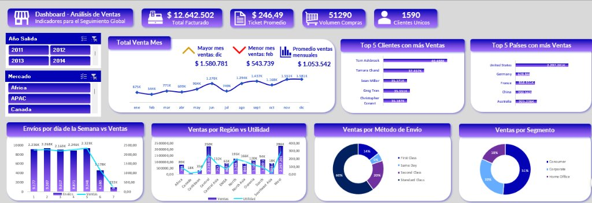
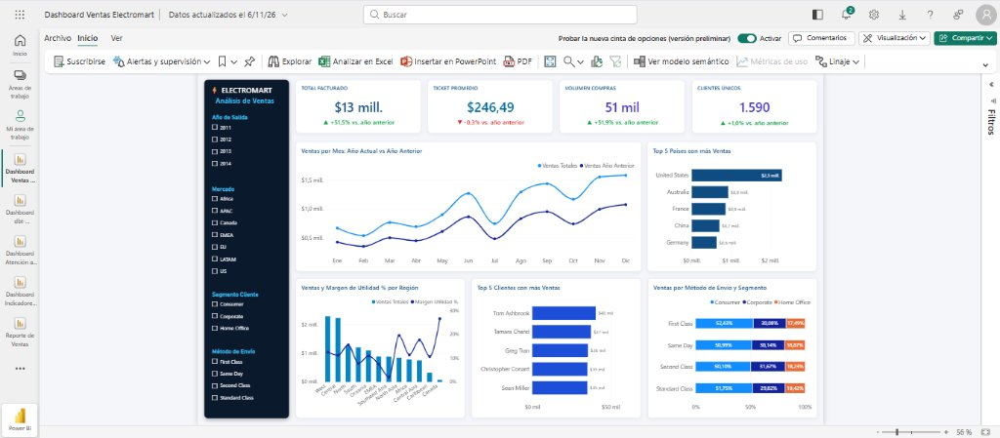
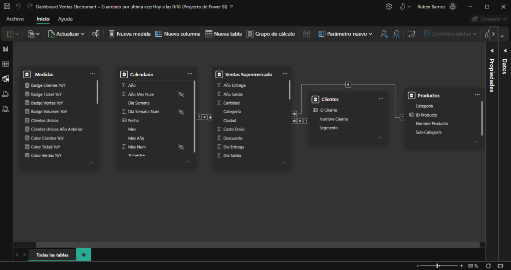
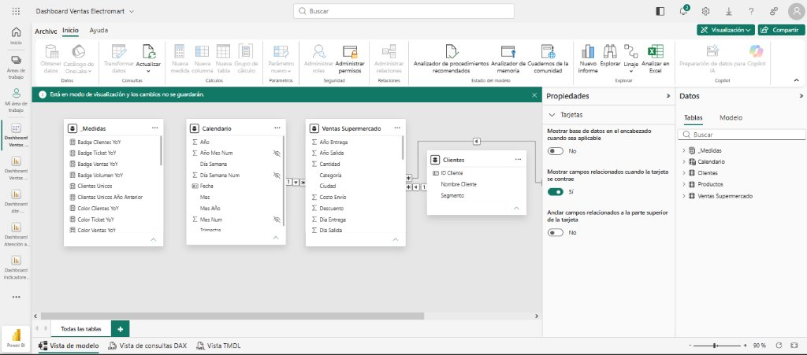

# ⚡ Dashboard Ejecutivo de Ventas — Electromart (De Excel a Power BI)

[](https://app.powerbi.com/groups/me/reports/b6b39ac8-21ee-4414-b3d6-ebb41c057b20/429d87bf754c01dc360e?experience=power-bi)


> **De una hoja de cálculo en Excel a un Centro de Control Ejecutivo en Power BI:** Caso de estudio de migración, modelado dimensional, gobierno de datos, inteligencia temporal avanzada en DAX y diseño de experiencia de usuario (UX/UI) orientado a la alta dirección.

---

## 📌 Tabla de Contenidos
1. [El Salto de Nivel: Antes (Excel) vs. Después (Power BI)](#-el-salto-de-nivel-antes-excel-vs-después-power-bi)
2. [Contexto de Negocio & Datos Transaccionales](#-contexto-de-negocio--datos-transaccionales)
3. [Arquitectura de Datos y Modelado en Estrella](#-arquitectura-de-datos-y-modelado-en-estrella)
4. [La Dimensión Calendario: El Pilar de Inteligencia Temporal](#-la-dimensión-calendario-el-pilar-de-inteligencia-temporal)
5. [Lógica de Negocio y Métricas Clave (DAX)](#-lógica-de-negocio-y-métricas-clave-dax)
6. [Hallazgos Comerciales y Toma de Decisiones](#-hallazgos-comerciales-y-toma-de-decisiones)
7. [Diseño UX/UI y Sistema Visual](#-diseño-uxui-y-sistema-visual)
8. [Estructura del Proyecto (PBIP)](#-estructura-del-proyecto-pbip)
9. [Cómo Abrir e Inspeccionar el Proyecto](#-cómo-abrir-e-inspeccionar-el-proyecto)

---

## 🔄 El Salto de Nivel: Antes (Excel) vs. Después (Power BI)

Este proyecto nace de una necesidad recurrente en las organizaciones: **superar las limitaciones de las hojas de cálculo para la toma de decisiones estratégicas**. 

Aunque el prototipo inicial en Excel permitía una visualización básica de los datos, presentaba barreras críticas: dependía de tablas dinámicas con ordenamientos manuales, carecía de inteligencia temporal interanual y no permitía correlacionar volumen de venta frente a rentabilidad neta real.

### 🖼️ Comparativa Visual de la Evolución

#### 🔴 El Antes: Prototipo en Hojas de Cálculo (Excel)
*Diseño skeumórfico con degradados morados, métricas estáticas sin comparativas anuales, ordenamiento alfabético en regiones y donas desarticuladas.*



---

#### 🟢 El Después: Centro de Control Ejecutivo en la Nube (Power BI Service)
*Diseño moderno de alto contraste con Sidebar Navy corporativo, KPIs dinámicos con variación interanual (YoY), gráfico combinado de ventas vs. margen y barras 100% apiladas, desplegado y operativo en Power BI Service.*

[](https://app.powerbi.com/groups/me/reports/b6b39ac8-21ee-4414-b3d6-ebb41c057b20/429d87bf754c01dc360e?experience=power-bi)



---

### 📊 Matriz de Madurez Analítica

| Componente | Prototipo Inicial (Excel) | Cuadro de Mando Ejecutivo (Power BI) |
| :--- | :--- | :--- |
| **Arquitectura de Datos** | Tabla plana transaccional con fórmulas de búsqueda. | **Modelo Dimensional en Estrella** con relaciones 1:N puras. |
| **Dimensión Temporal** | Columna de fecha transaccional con huecos en días festivos. | **Tabla Calendario contigua** (1.461 días) para `Time Intelligence`. |
| **KPIs Principales** | Cifras fijas aisladas (\$12.642.502, \$246,49). | **Insignias dinámicas YoY** con flechas direccionales (`▲` / `▼`) y alertas condicionales en color. |
| **Evolución Temporal** | Una sola línea de ventas mensuales. | **Doble serie temporal**: Año Actual vs. Año Anterior (`SAMEPERIODLASTYEAR`). |
| **Análisis Regional** | Columnas ordenadas alfabéticamente (Africa, Canada, Caribbean...). | **Combo Chart (Columnas + Línea)** ordenado por impacto, contrastando volumen (\$ en barras) vs. rentabilidad (% en línea). |
| **Rankings (Top 5)** | Ordenamientos afectados por sesgos manuales de tabla dinámica. | **Medidas DAX `RANKX` estrictas** que corrigen automáticamente empates y posiciones. |
| **Logística y Segmentación** | 2 gráficos de dona desconectados entre sí. | **Barras 100% Apiladas** cruzando método de envío con distribución por tipo de cliente. |

---

## 🏢 Contexto de Negocio & Datos Transaccionales

**Electromart** es una cadena global de venta minorista (Retail) de tecnología, electrodomésticos y suministros de oficina. El conjunto de datos auditado contiene el historial de operaciones internacionales a nivel de ítem vendido:

* **Volumen de transacciones:** `51.290` filas auditadas (100% depuradas de inconsistencias `#REF!` y nulos).
* **Facturación total global:** `$12.642.501,91 USD` (~`$12,64M`).
* **Utilidad neta global:** `$1.467.457,29 USD` (~`$1,47M`).
* **Margen de rentabilidad global:** `11,61%`.
* **Clientes únicos atendidos:** `1.590` clientes B2B y B2C.
* **Catálogo de productos:** `10.292` ítems clasificados en 3 categorías (*Tecnología*, *Mobiliario*, *Suministros de Oficina*).
* **Cobertura geográfica:** `147` países agrupados en `12` regiones operativas y `7` mercados mundiales.
* **Periodo de análisis:** `2011 - 2014` (4 ejercicios fiscales completos).

---

## 🧱 Arquitectura de Datos y Modelado en Estrella

Para asegurar tiempos de respuesta inmediatos, evitar ambigüedades en los filtros cruzados y mantener un gobierno de datos limpio y profesional, se estructuró un **Modelo de Datos en Estrella (Star Schema)**:



#### ☁️ Modelo Semántico Desplegado en la Nube (Power BI Service)
El modelo semántico relacional en estrella y la totalidad de medidas DAX se encuentran completamente publicados, gobernados y operativos en **Power BI Service (Cloud)**:



> **Estructura relacional limpia:** La tabla de hechos transaccional (`Ventas Supermercado`) se ubica en el centro, rodeada por sus dimensiones maestras conectadas mediante relaciones unidireccionales 1:N (`Calendario`, `Clientes`, `Productos`), y con una tabla contenedora desacoplada (`_Medidas`) que centraliza toda la lógica analítica.

```mermaid
erDiagram
    Calendario ||--o{ Ventas_Supermercado : "1:N (Fecha Salida)"
    Clientes ||--o{ Ventas_Supermercado : "1:N (ID Cliente)"
    Productos ||--o{ Ventas_Supermercado : "1:N (ID Producto)"
    _Medidas ||-- Ventas_Supermercado : "Cálculos DAX"

    Calendario {
        date Fecha PK
        int Año
        string Mes
        int Mes_Num
        string Trimestre
    }

    Clientes {
        string ID_Cliente PK
        string Nombre_Cliente
        string Segmento
    }

    Productos {
        string ID_Producto PK
        string Nombre_Producto
        string Categoría
        string Sub_Categoría
    }

    Ventas_Supermercado {
        int Numero_Venta PK
        string ID_Cliente FK
        string ID_Producto FK
        date Fecha_Salida FK
        float Ventas
        float Utilidad
        float Costo_Envio
        string Metodo_Envio
        string Pais
        string Region
        string Mercado
    }
```

### Tablas del Modelo Semántico (TMDL):
1. **`Ventas Supermercado` (Fact):** Contiene las 51.290 transacciones, cantidades vendidas, importes facturados, descuentos y márgenes reales.
2. **`Calendario` (Dimensión Temporal):** Generada mediante DAX contiguo para gobernar las jerarquías de tiempo.
3. **`Clientes` (Dimensión Cliente):** Tabla dimensional limpia con 1.590 clientes únicos desduplicados y su correspondiente segmento (*Consumer*, *Corporate*, *Home Office*).
4. **`Productos` (Dimensión Producto):** Catálogo de 10.292 productos únicos agrupados por categoría y subcategoría.
5. **`_Medidas` (Contenedor de Lógica de Negocio):** Tabla desacoplada que aloja exclusivamente las medidas DAX estructuradas por carpetas de despliegue (`01 KPIs`, `02 Rentabilidad`, `03 Logística`, `04 Dinámica Temporal`).

---

## 🗓️ La Dimensión Calendario: El Pilar de Inteligencia Temporal

Un error frecuente al construir dashboards es reutilizar la columna de fecha de la tabla de hechos. En este proyecto se construyó una **tabla calendario dedicada** con 1.461 fechas continuas (2011 a 2014) por cuatro motivos fundamentales:

1. **Requisito estricto de DAX Time Intelligence:** Funciones como `SAMEPERIODLASTYEAR` requieren una secuencia continua de fechas sin huecos. Si un día festivo o domingo no registra ventas, la tabla transaccional salta ese día, lo que causaría cálculos interanuales distorsionados.
2. **Garantía de Orden Cronológico:** Se configuró la columna `Mes` con `sortByColumn: 'Mes Num'`. Esto evita que Power BI ordene los meses alfabéticamente (*Abril, Agosto, Diciembre, Enero...*) forzando la visualización natural de **Enero a Diciembre**.
3. **Optimización del Motor VertiPaq:** Calcular atributos temporales (*Trimestre*, *Nombre de Mes*, *Año-Mes*) sobre 1.461 filas en lugar de repetirlos en las 51.290 filas de ventas reduce drásticamente el consumo de memoria RAM y acelera el renderizado.

---

## 📐 Lógica de Negocio y Métricas Clave (DAX)

### 1. Ventas y Comparativa Interanual (YoY)
```dax
Ventas Totales = 
SUM ( 'Ventas Supermercado'[Ventas] )

Ventas Año Anterior = 
CALCULATE ( 
    [Ventas Totales], 
    SAMEPERIODLASTYEAR ( 'Calendario'[Fecha] ) 
)

Variacion Ventas YoY % = 
DIVIDE ( 
    [Ventas Totales] - [Ventas Año Anterior], 
    [Ventas Año Anterior], 
    0 
)
```

### 2. Formato Condicional Inteligente y Detección de Año Base
Para que las tarjetas no muestren errores de división por cero en el primer año histórico (2011) y adapten su color en tiempo real:

```dax
Badge Ventas YoY = 
VAR _ant = [Ventas Año Anterior]
VAR _pct = [Variacion Ventas YoY %]
RETURN
    IF (
        ISBLANK ( _ant ) || _ant = 0,
        "Año base (2011)",
        IF ( _pct >= 0, "▲ +" & FORMAT ( _pct, "0.0%" ) & " vs. año anterior", "▼ " & FORMAT ( _pct, "0.0%" ) & " vs. año anterior" )
    )

Color Ventas YoY = 
VAR _ant = [Ventas Año Anterior]
VAR _pct = [Variacion Ventas YoY %]
RETURN
    IF (
        ISBLANK ( _ant ) || _ant = 0,
        "#64748B",  -- Gris neutro para Año Base
        IF ( _pct >= 0, "#16A34A", "#DC2626" ) -- Verde si sube, Rojo si cae
    )
```

### 3. Ranking Estricto sin Sesgos (`RANKX`)
```dax
Ventas Top 5 Países = 
VAR _Rk = RANKX ( ALLSELECTED ( 'Ventas Supermercado'[País] ), [Ventas Totales], , DESC )
RETURN 
    IF ( _Rk <= 5, [Ventas Totales] )
```

---

## 💡 Hallazgos Comerciales y Toma de Decisiones

El valor de un cuadro de mando reside en las decisiones que impulsa. La migración a Power BI reveló cinco patrones que permanecían ocultos en las hojas de cálculo tradicionales:

### 1️⃣ La Trampa de Volumen en Southeast Asia
* En las tablas dinámicas de Excel, **Southeast Asia** figuraba como un mercado destacado por facturar **`$884.423 USD`** (7° región en ventas globales).
* Sin embargo, el nuevo gráfico combinado de *Ventas vs. Margen %* desnudó su verdadera situación financiera: su margen de utilidad neta es de **apenas el 2,02%** (`$17.852 USD`).
* **Contraste:** Regiones como **North Asia** facturan un volumen similar (`$848.270 USD`) pero con un margen del **19,52%** (`$165.595 USD`), y **Canada** lidera la compañía con un margen récord del **26,62%**.
* **Decisión Estratégica:** Frenar la política agresiva de descuentos en el sudeste asiático y reestructurar costos logísticos para defender el margen neto.

### 2️⃣ Alerta Roja en el Ticket Promedio (-0,3%)
* A nivel global, la facturación creció a `$12,64M` y el volumen de compras se disparó un **`+51,93%`** (de 33.759 a 51.290 órdenes).
* No obstante, el **Ticket Promedio se contrajo ligeramente en un `-0,26%`** (de `$247,12` a `$246,49` por compra).
* **Decisión Estratégica:** Diseñar estrategias de venta cruzada (*cross-selling*) y empaquetamiento (*bundling*) para elevar el valor promedio por carrito.

### 3️⃣ Estacionalidad y Rally de Cierre de Año
* La serie temporal cronológica demostró un patrón cíclico de alta fidelidad: pronunciados valles de venta en **febrero** (`$544K`) y **julio** (`$749K`), seguidos de una aceleración masiva en el último cuatrimestre que culmina en **noviembre y diciembre superando los `$1,58M USD mensuales`**.
* **Decisión Operativa:** Planificar aprovisionamiento de stock con 90 días de anticipación y optimizar la capacidad de distribución para el rally de Q4.

### 4️⃣ Concentración en Estados Unidos
* **United States** lidera con **`$2,30 Millones USD`**, superando por más del doble a los siguientes competidores (Australia con `$925K` y Francia con `$859K`). EE.UU. representa por sí solo casi una quinta parte de los ingresos mundiales.

### 5️⃣ Estabilidad en la Matriz de Envíos
* El **`51%` de todas las órdenes en cualquier modalidad de envío proviene del segmento Consumidor (*Consumer*)**, seguido de Corporativo (~30%) y Home Office (~18%). Incluso en modalidades de entrega inmediata (*Same Day*), el consumidor final representa más del 50%, validando que el cliente particular prioriza la velocidad de entrega.

---

## 🎨 Diseño UX/UI y Sistema Visual

El cuadro de mando fue proyectado bajo los principios de reducción de carga cognitiva y leyes de percepción visual de la **Gestalt**:

* **Canvas Resolution:** 1920 × 1080 px (Full HD 16:9), optimizado para salas de juntas y pantallas de dirección.
* **Paleta de Color Semántica:**
  * 🟦 **Deep Navy (`#0B192C`):** Sidebar lateral de alto contraste para aislamiento visual de los controles.
  * ⚪ **Slate Light Canvas (`#F4F6F9`):** Fondo neutro que reduce el cansancio visual.
  * 🏢 **Corporate Blue (`#0F4C81` / `#0284C7`):** Color primario de facturación y volumen.
  * 🟢 **Success Green (`#16A34A`):** Indicador positivo de crecimiento anual.
  * 🔴 **Alert Red (`#DC2626`):** Señalética de contracción o margen crítico.
* **Tipografía:** *Segoe UI Semibold* con estricta jerarquía de lectura (Títulos en 11-14 pt, Métricas en 26-30 pt).

---

## 📁 Estructura del Proyecto (PBIP)

El repositorio utiliza el formato moderno **Power BI Project (`.pbip`)**, permitiendo control de versiones en Git y colaboración en equipo sin archivos binarios opacos:

```
dashboard-ventas-electromart/
│
├── Dashboard Ventas Electromart.pbip           # Archivo de inicio en Power BI Desktop
│
├── Dashboard Ventas Electromart.Report/        # Definición del reporte (PBIR)
│   └── definition/
│       ├── pages/
│       │   └── 429d87bf754c01dc360e/
│       │       ├── page.json                  # Metadatos del canvas 1920x1080
│       │       └── visuals/                   # 19 contenedores visuales desacoplados
│       └── report.json
│
├── Dashboard Ventas Electromart.SemanticModel/ # Modelo Semántico (TMDL)
│   └── definition/
│       ├── model.tmdl                         # Configuración del modelo y culturas
│       ├── relationships.tmdl                 # Relaciones 1:N del Esquema Estrella
│       └── tables/
│           ├── _Medidas.tmdl                  # Código DAX de KPIs y colores
│           ├── Calendario.tmdl                # Dimensión temporal continua
│           ├── Clientes.tmdl                  # Dimensión clientes
│           ├── Productos.tmdl                 # Dimensión productos
│           └── Ventas Supermercado.tmdl       # Tabla Fact transaccional
│
├── assets/                                    # Imágenes y recursos del README
│   ├── dashboard_excel_antes.jpg
│   ├── dashboard_powerbi_despues.jpg
│   ├── dashboard_powerbi_service.jpg
│   ├── modelo_estrella_powerbi.png
│   └── modelo_semantico_powerbi_service.jpg
│
├── ventas_electromart.xlsx                    # Dataset transaccional auditado (51.290 filas)
├── dimensiones_electromart.xlsx               # Tablas auxiliares de clientes y productos
└── README.md                                  # Documentación técnica y ejecutiva
```

---

## 🚀 Cómo Abrir e Inspeccionar el Proyecto

### Requisitos Previos:
* **Power BI Desktop** (Versión 2024 o superior con compatibilidad para proyectos PBIP activada en *Opciones > Características de versión preliminar > Formato de archivo de proyecto de Power BI*).

### Pasos:
1. Clonar el repositorio localmente:
   ```bash
   git clone https://github.com/rubenbarrios-bigdata/dashboard-ventas-electromart.git
   ```
2. Entrar al directorio del proyecto:
   ```bash
   cd dashboard-ventas-electromart
   ```
3. Hacer doble clic sobre el archivo **`Dashboard Ventas Electromart.pbip`** para inicializar el reporte directamente con todas las tablas TMDL y visuales PBIR enlazados.

---

## 👨‍💻 Autor
**Rubén David Barrios Bello**  
*Data & Business Intelligence Analyst*  
* [LinkedIn](https://linkedin.com/in/rubenbarrios-bigdata) • [GitHub](https://github.com/rubenbarrios-bigdata) • [Portfolio](https://rubenbarrios-bigdata.github.io)

